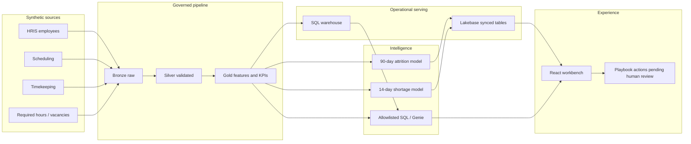

# Architecture

CareStaff Insight is a planning workbench for health-system workforce risk. One logical design, two runtimes. Same table names. Same silver/gold SQL (from Increment 3). Local is how you test. Databricks is the customer platform story after you connect this Git repo in a workspace.

## Runtime split

| Stage | Local fallback | Databricks path |
|---|---|---|
| Generate | `python -m data_generation` → CSV | Same files in a UC Volume |
| Bronze | Register raw files | Lakeflow tables reading a UC Volume |
| Silver / gold | DuckDB runs the SQL | Spark Declarative Pipelines + materialized views |
| DQ | pytest + SQL assertions | Pipeline expectations |
| ML | sklearn/LightGBM + local MLflow | Workspace MLflow, same pyfunc |
| Operational serving | DuckDB gold | Lakebase Autoscaling synced tables for exec brief, risk, and shortage |
| Model inference | In-process `predict()` | In-process `predict()`; no Model Serving endpoint |
| AI | Allowlisted SQL tools + citation validator; template fallback | Genie on gold + FM API narrating tool results only |
| UX | FastAPI + React (`app.py`, `frontend/`) | Same app as a Databricks App + walkthrough notebook |

Do not claim Model Serving or Genie is live unless it has been deployed.

## End-to-end flow

## Current increment

The repository includes the generator, React workbench, Git-folder Lakeflow recipe, workspace scoring and metric-view notebooks, Lakebase synced-table notebook, and FE Bar pack ([fe_bar.md](fe_bar.md)). Operator steps: [workspace.md](workspace.md). **Not auto-deployed.** Model Serving is not used. Actions are never auto-applied.

Training is production-honest: only labels whose window ends on or before as_of. Metrics on the as_of roster use generator future labels and are labeled `inference_demo_oracle`. Fairness slices are operational (role, facility, tenure, shift, unit) — the data has no protected class.

Gold grains:

- `employee_month_features` — employee × snapshot (month-ends + frozen as_of). Lookbacks use only dates ≤ snapshot. Label = voluntary separation in `(snapshot, snapshot+90d]`.
- `unit_day_coverage` — department × date. Shortage day if coverage < 0.90 or open-shift share > 0.10.
- `unit_week_features` — department × week. 14-day shortage label is trainable only when `week_end+14 <= as_of` (no coverage data exists after as_of).
- `executive_kpis` — one row at as_of. Operational only (overtime, vacancy, observed attrition, coverage gap, labeled dollar assumptions).
- `employee_risk_scores` / `unit_shortage_forecast` / `exec_brief` — Increment 4 scores. High-risk is a planning quantile, status pending human review.
- `recommended_actions` / `whatif_scenarios` / `action_summary` — Increment 5. Closed playbook. Status is always `pending_human_review`. What-if perturbs a copy of features; silver/gold feature tables are not rewritten.

## AI grounding rule

The assistant never computes a KPI in prose. It calls an allowlisted tool, quotes numbers from the result, and cites the table or query id. A validator rejects numeric claims that did not come from a tool.

Local path: `uv run python -m src.ai "..."`. Tools in `src/ai/tools.py` (gold SQL + in-process `predict_*`). Narration is template-only (`conf.default.yaml` `ai.mode: template`). `ai.genie_live` and `ai.model_serving_live` stay false until a workspace space / endpoint exists. The same tool catalog is what a Genie space on gold would expose after deploy — that is not claimed here.

## Label definitions

- **Attrition:** employee active at month-end `t`; positive if a **voluntary** separation occurs in `(t, t+90 days]`.
- **Shortage:** `coverage_ratio = productive_hours / required_hours`. Positive if coverage `< 0.90` or open-shift share `> 0.10`. Primary forecast window: 14 days.

## Cost layer

`role_cost_assumptions` holds role-average salaries from config. Individual `salary` is not a column on `employees` and is not a model feature. Compensation **band** (B1/B2/B3) is.
